又到了快客小哥推荐小众宝藏景点的时候了！这次要给大家安利的 **Yarndleys Bush**，是当地人私藏的非著名秘境，在谷歌点评上拥有 **4.5 分** 的好口碑. **详细攻略参考**：[http://bit.ly/35R2MxL](http://bit.ly/35R2MxL)

整片保护区占地 14 公顷（0.14 平方公里，约 34.6 亩）。走进里面，参天大树林立，盘根错节的树根布满地表，仿佛一脚踏进了《指环王》里的“中土世界”。其中一些古老的 **Kahikatea（新西兰鸡毛松）** 更是高达 35 米，原始森林的壮观与静谧感拉满！

---

##出行速览与实用贴士

* **适合人群**：所有人（尤其适合家庭轻徒步、自然探索） 
* **活动概况**：森林徒步 + 户外野餐  
* **游玩时长**：约 1 小时  
* **地理位置**：谷歌地图直接搜索 **[Yarndley's Bush](https://www.google.com/maps/place/Yarndley's+Bush/@-37.9806197,175.3115258,896m/data=!3m1!1e3!4m5!3m4!1s0x6d6ce6d9027328a3:0x3399a7c53dc47de6!8m2!3d-37.9836535!4d175.3152373)**（位于怀卡托地区）
 
 

* **路况提示**：景区内部铺设有木栈道，适合步行，但**不适合推婴儿车或轮椅**；如遇雨天，部分泥土路段会比较泥泞，建议穿防滑运动鞋或徒步鞋。

---

##详细行程与避坑指南

### 1. 停车与安全提醒（极其重要！）
* **切勿路边违停**：从 3 号公路（SH3）方向开过来时，路边能看到紫底白字的景点指示牌，但路边**严禁停车**（也不要直接开上草地）。  
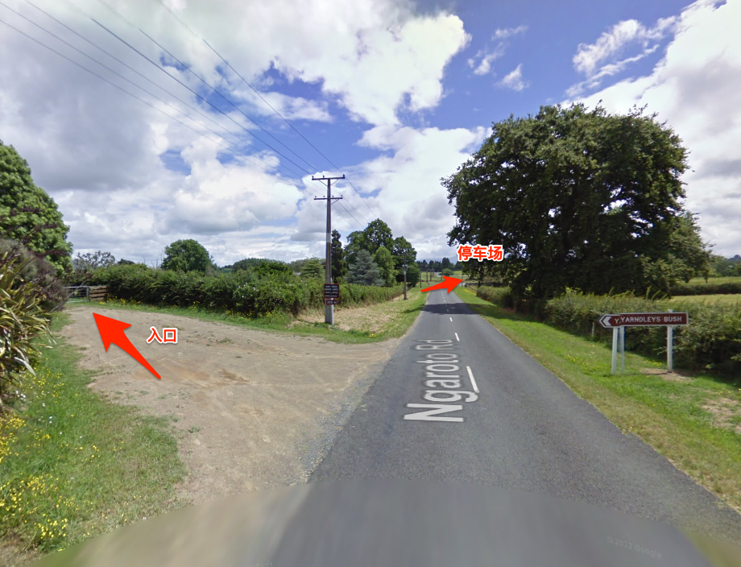
* **专用停车场**：顺着路牌继续往前开大约 **200 米**，右手边就是专属的硬化路面停车场，车况和地面都不错。  
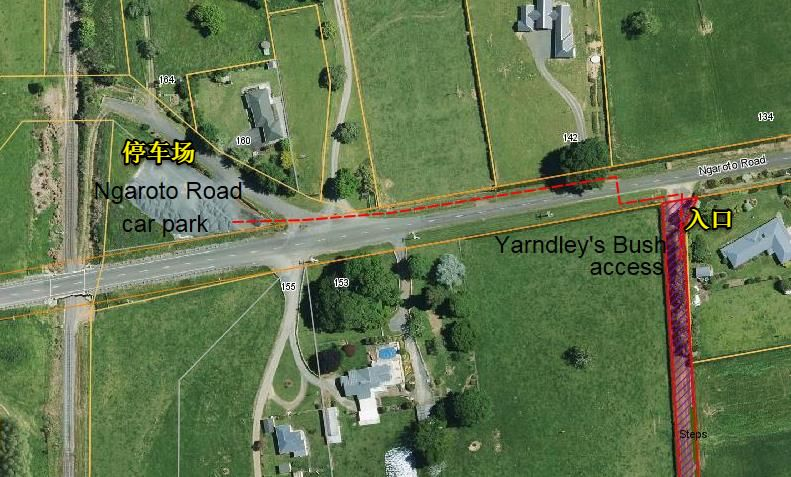
* **步行安全**：停好车后，需要沿着公路边步行折返至景区入口。这段路属于乡村公路，虽然车流量不大，但**过往车辆车速极快**，步行时务必靠边行走，**大人一定要紧紧看好小朋友**！  
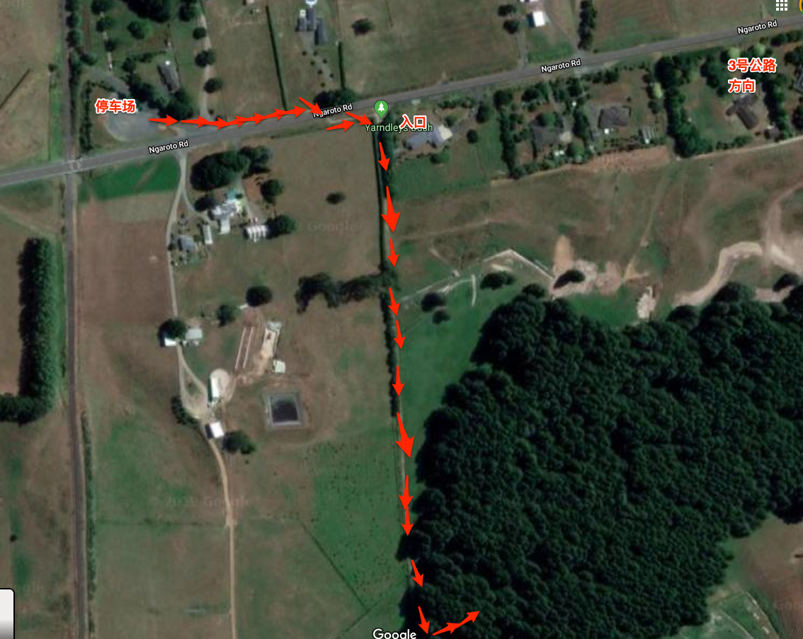

### 2. 进入森林秘境
* **免费开放**：景区入口非常原生态且简陋，没有售票处也没有工作人员站岗，推门自己走进去就行。一旦进入大门，里面就是全封闭的自然环境，小朋友可以彻底撒欢奔跑。  
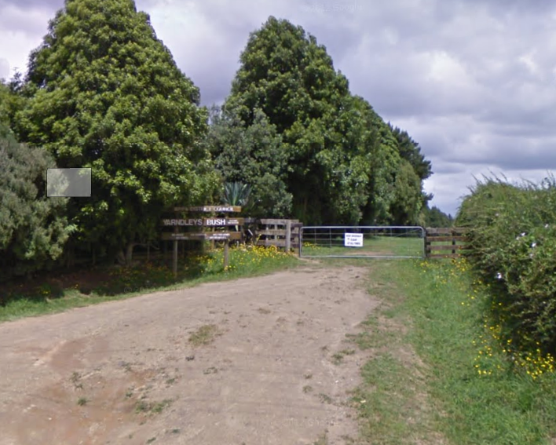

* **田园牧场风光**：刚进去会经过一片开阔的草地，随后是一段带台阶的下坡路。左手边是典型的怀卡托牧场，通常能看到成群的牛或马在悠闲吃草；右手边则是一片茂密的树林。  
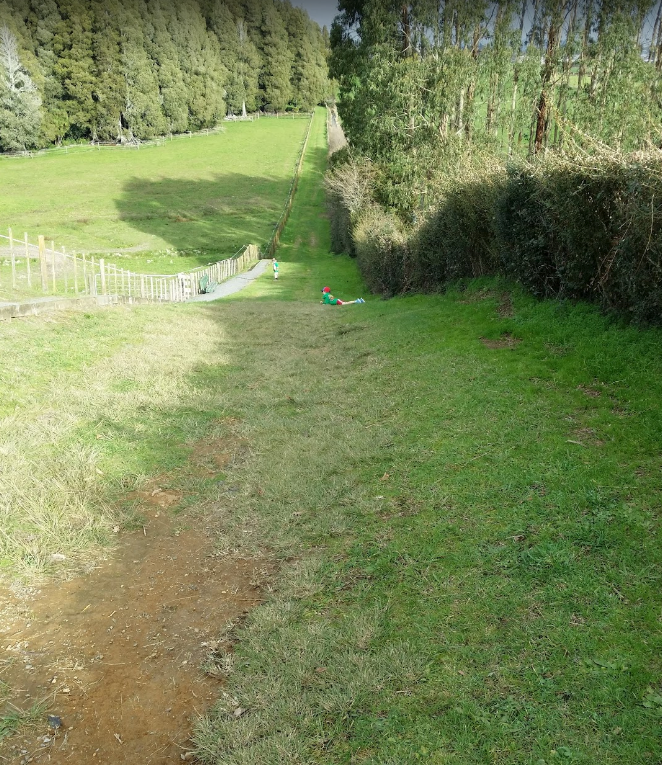

* **步入“中土世界”**：走到草地尽头便是真正的森林入口，左手边立有景区的生态介绍牌。刚一跨进去，迎接你的就是遮天蔽日的参天巨树，盘根错节的树根裸露在地面上，苔藓密布，瞬间带你穿越进魔戒电影里的中土森林。  
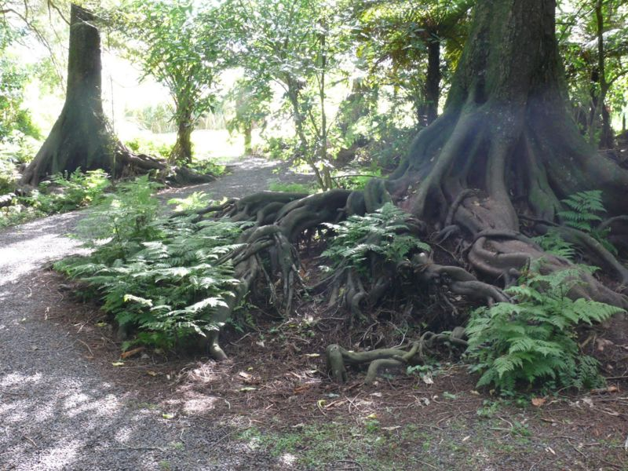

### 3. 森林漫步与树冠瞭望台
* 沿着弯弯曲曲的木质小径深入腹地，四周绿树成荫，耳边是不知名鸟儿的清脆鸣唱，阳光透过高耸树冠的缝隙洒下来，斑驳地照在树干的青苔上，空气清新得让人想深呼吸。  
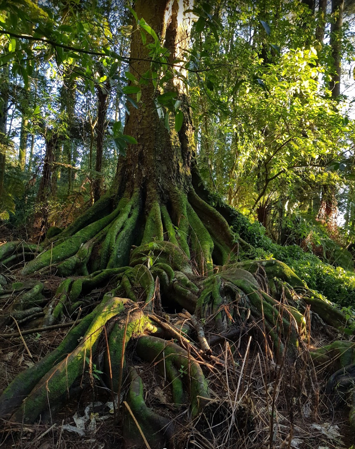

* 走没多久，就会遇到一座隐藏在林间的**木质瞭望台**。登上去后，人仿佛置身于参天大树的半腰之间——虽然因为树林茂密看不了太远，但这种登高俯视周围树丛、平视树冠层细节的视角非常独特。  
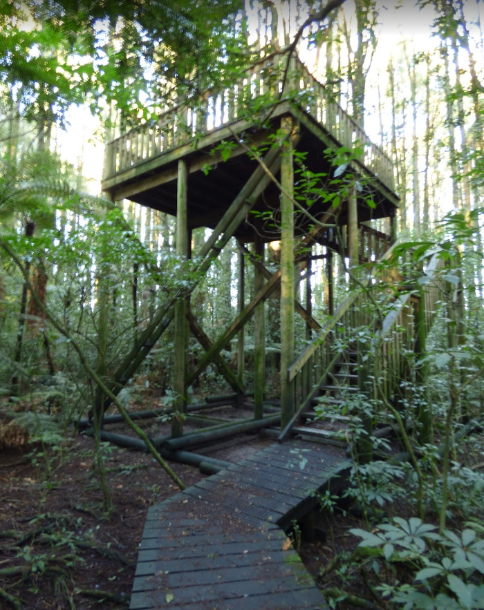
---

## 三、 森林寻宝清单：你能遇见它们吗？

Yarndleys Bush 不仅植物茂密，更是本地野生动物的栖息地。带小朋友来的话，不妨照着下面这份“自然寻宝清单”一一打卡：

* **🌿 标志性植物**：
  * **新西兰鸡毛松（Kahikatea）**：新西兰最高的本土树种，高达 35 米，树干笔直如擎天柱。  
  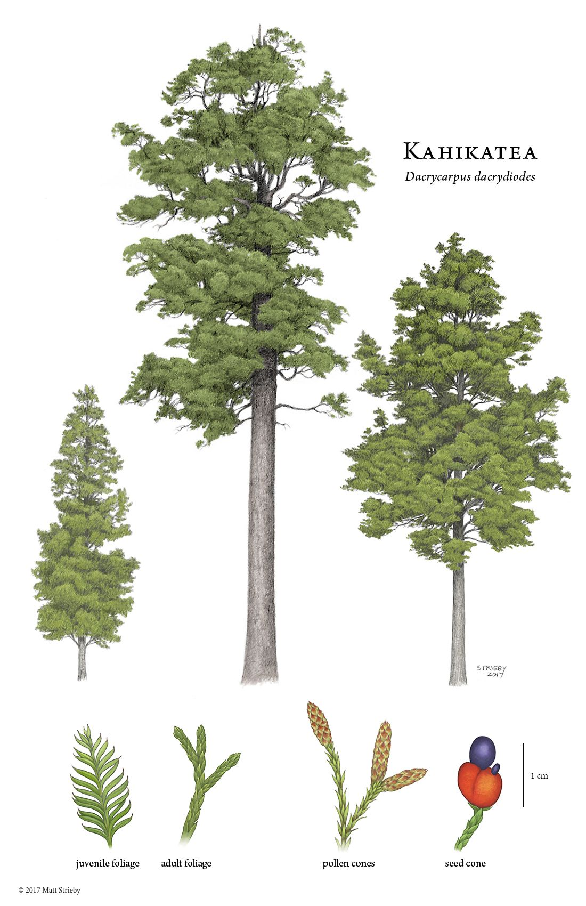
* **🐦 常见林鸟**：
  * **扇尾鹟（Fantail / Pīwakawaka）**：尾巴像小扇子一样张开，特别喜欢跟着徒步者飞来飞去。  
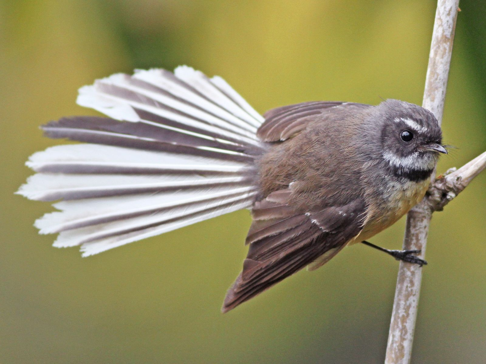  
  * **灰噪莺（Grey Warbler / Riroriro）**：体型娇小，歌声极其婉转动听。  
  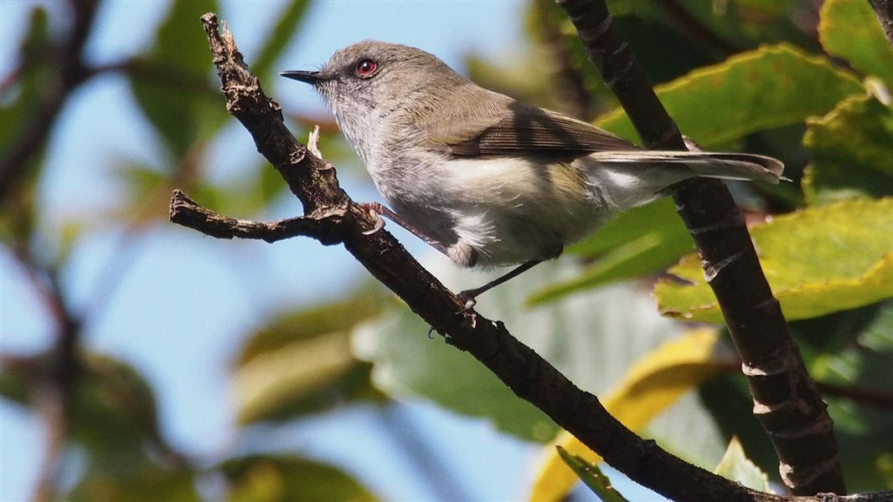
  * **图伊鸟（Tūī）**：脖子下挂着两撮标志性的白色羽毛球，叫声多变。   
  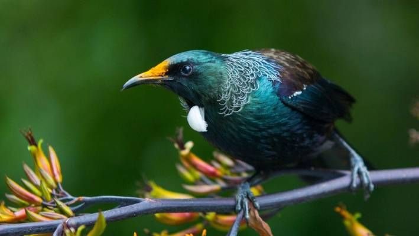

  * **雀类（Finches）**

  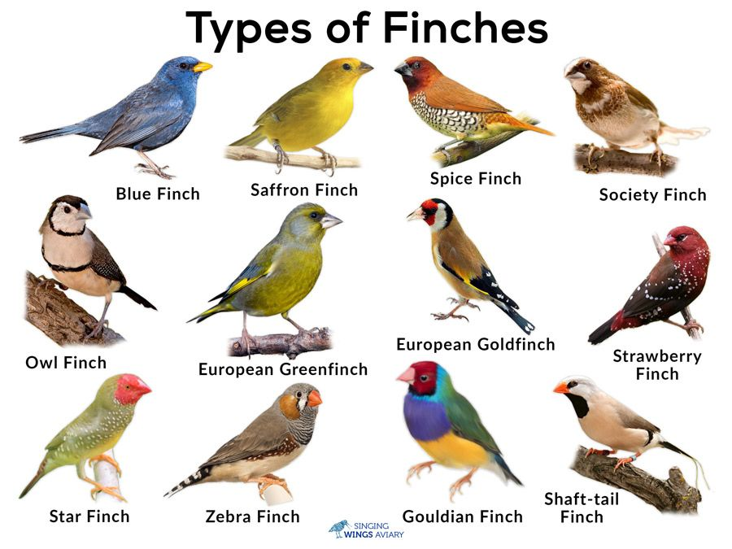  
  * **玫瑰鹦鹉（Rosella）**：色彩艳丽的林间精灵。
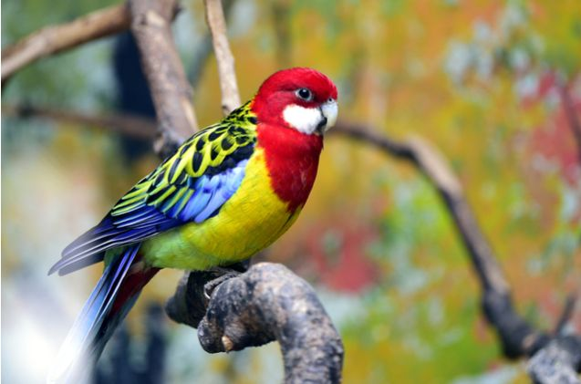  

  * **新西兰木鸽（New Zealand Pigeon / Kererū）**：体型胖乎乎、自带白色“围兜”的呆萌大鸟。

  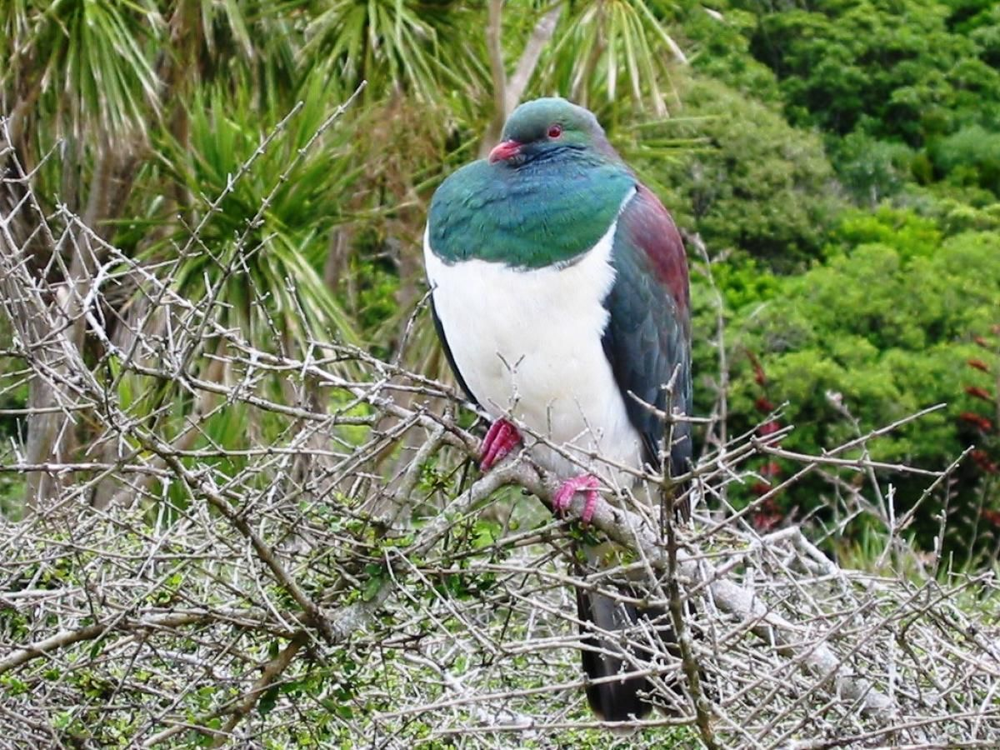  
* **🐟 溪流水中生物**（留意林间小溪）：
  * **鳟鱼（Trout）**
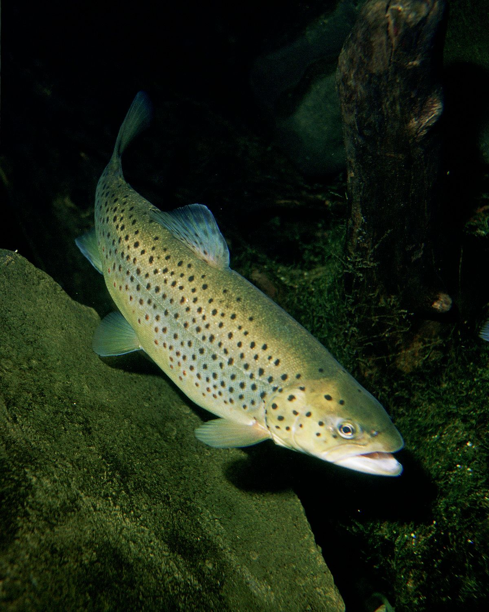  

  * **新西兰鳗鱼（Eel）**
  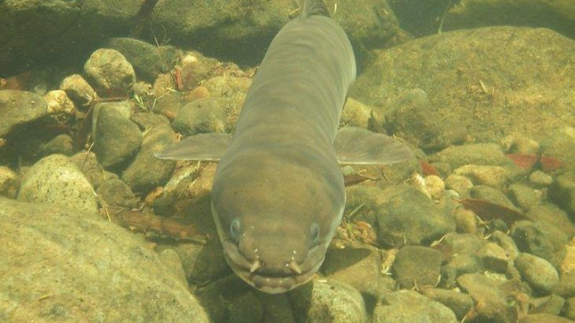  
  * **淡水小龙虾（Kōura）**：新西兰本土珍稀淡水小龙虾，水质极好才能见到。
  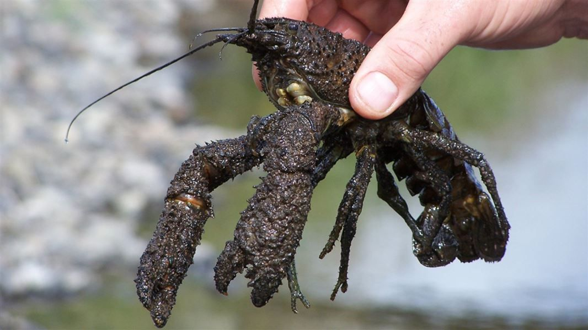  

如果你哪天去这里打卡了，碰巧在林间或小溪里看到了上面清单里的动植物，一定要在后台留言或者发朋友圈告诉我们哦！

---

---
【联系我们】
行程定制、包车、机场接送、微留学、亲子游、户外游、订住宿   
快客旅行（Xtravel Club） 
PO Box 107129 Auckland Airport  
 Auckland 2150

Mobile/手机：022 496 4978  
Email/邮箱：info@xtravel.club  
Web /网站：http://xtravel.club  
微信号/QQ： 496 4978  
扫描关注我们的企业微信号:   
