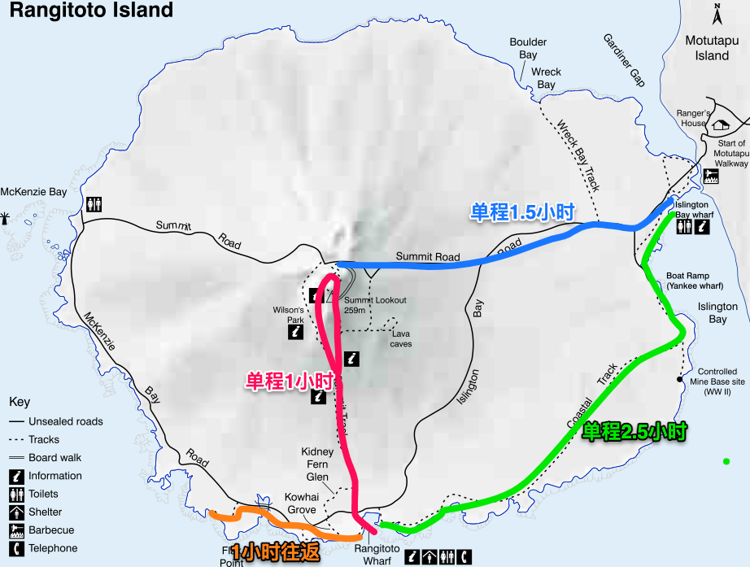
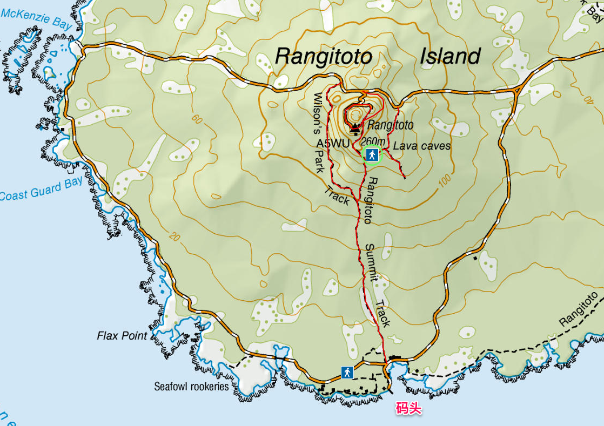
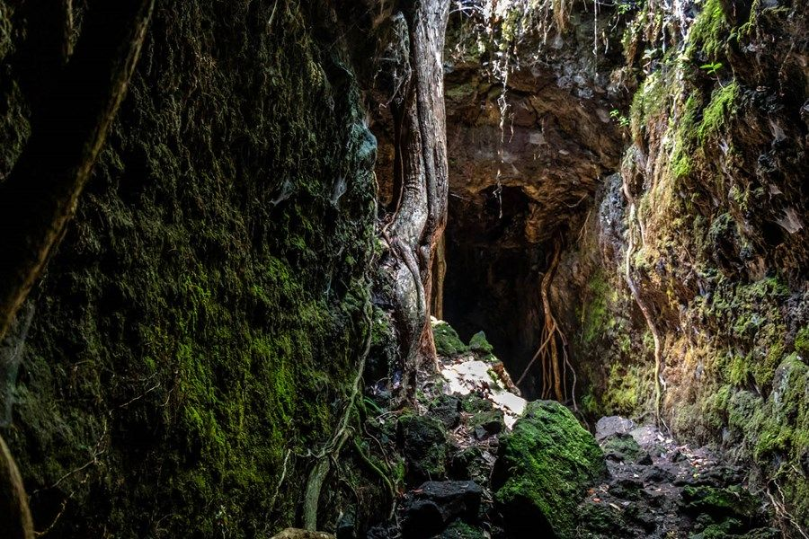
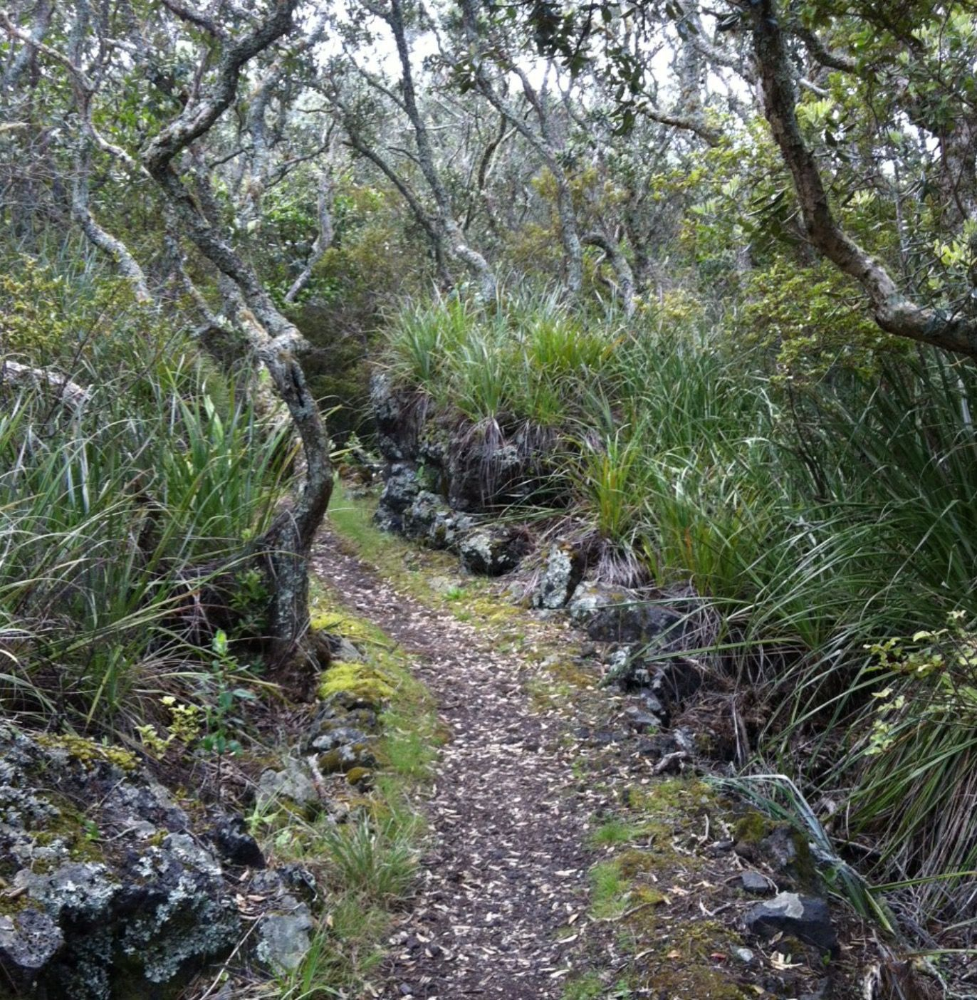
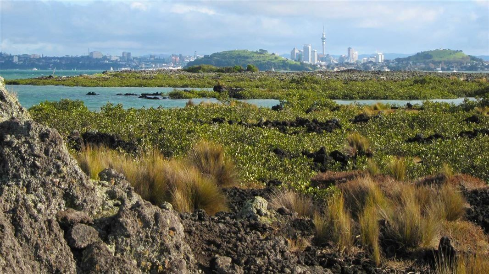
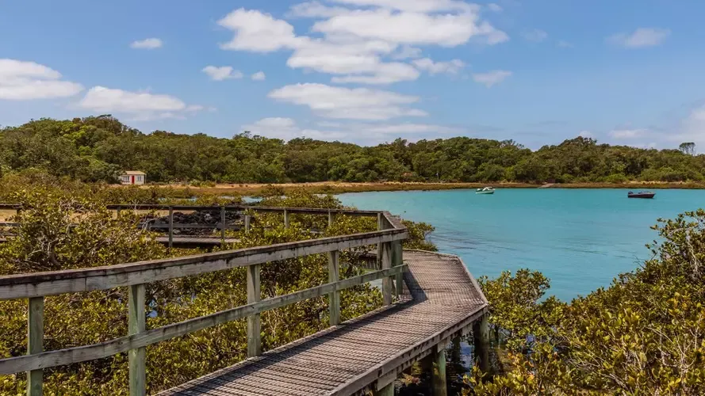

---
layout: post
title:  "【快客攻略】奥克兰一日徒步 Rangitoto Island：登上600年前的火山岛，360°俯瞰千帆之都"
author: 快客小哥
categories: [ 景点攻略, 新西兰旅游 ]
image: assets/images/ButtIsland/Rangitoto.jpg
tags: [ 奥克兰, Rangitoto Island, 火山岛, 徒步, 一日游, 快客旅行 ]
---

【快客攻略: 奥克兰一日徒步 Rangitoto Island：登上600年前的火山岛，360°俯瞰千帆之都】在奥克兰，你说Butt Island （屁股岛），都知道你说的啥，因为抬头就可以看到。它每天都在那里，看起来有点让人忍俊不止。它的来头却不小：诞生于大约 600 年前的一次剧烈火山喷发，如今整座岛屿依然覆盖着粗犷的黑色火山岩、茂密的原生植被以及迷人的海岸线。只需约 1 小时的徒步即可登顶，站在火山口 360° 俯瞰不远处的奥克兰天空塔（Sky Tower）与豪拉基湾的碧水蓝天，下山还能顺道钻进幽深的火山熔岩洞探险！今天我们就去奥克兰东边这座**面积最大却最年轻的火山岛——朗伊托托岛（Rangitoto Island）**。详情访问： 

---

## 一、 出行速览与装备贴士

* **徒步难度**：中等
* **游玩时间**：码头至山顶单程约 1 小时（往返 2 小时，总里程约 7 公里）；若加上周边支线步道，可灵活安排 2 至 6 小时。当天往返要看轮渡时间来安排。
* **步道状况**：全程以碎石和火山岩渣路面为主，**不适合推轮椅或婴儿车**。建议务必穿防滑、耐造的登山鞋或徒步鞋。
* **必备装备**：
  * **头灯或手电筒**：探索火山熔岩洞（Lava Caves）必备，手机闪光灯亮度往往不够。
  * **充足饮水与干粮**：**岛上没有任何商店、咖啡馆或餐厅**，所有食物和饮用水必须自备，且垃圾需全部带回市区。
  * **防晒与防风衣物**：火山岩吸热且山顶风大，注意防晒与防风。

---

## 二、 轮渡时刻表与票价参考 (Fullers Ferry)

前往 Rangitoto Island 需搭乘 **Fullers** 轮渡，可从奥克兰市区码头（Downtown Auckland）或北岸 Devonport 出发。

### 1. [往返参考票价（建议提前网购）](https://www.fullers.co.nz/destinations-and-experiences/destinations/rangitoto-island?from=AUCK&to=RANG&date=2026-11-16)
* **成人**：63 纽币（网购特惠价；码头现场买票通常略贵，约 47 纽币）
* **青少年（5 - 15 岁）**：28.5 纽币
* **儿童（0 - 5 岁）**：免费

### 2. 轮渡参考时刻表
| 航线方向 | 工作日（周一至周五） | 周末（周六及周日） |
| :--- | :--- | :--- |
| **奥克兰市区码头 ➔ Rangitoto** | 9.30 AM/10.30am/12.15pm | 9.15am/10:30 AM/12.15pm |
| **Rangitoto ➔ 奥克兰市区码头** | 12:45PM / 2:30 PM / 3:30 PM | 12:45 PM / 2:30 PM / 4:00 PM |

* **时间精算**：周一至周五 9.30 出发，10:30 抵达，按下午3.30返回算，岛上可自由安排**5 小时**；周末早班船提前晚班船推后，在岛上能足足多玩 **1 个小时**！*(注：船期随季节可能微调，出行前请务必在 Fullers 官网确认最新班次)*。

---

## 三、 四大徒步路线全解析

### 选项 1：经典主线直接登顶（单程约 1 小时｜最推荐）
* **路线亮点**：从码头下船后，直接沿着主步道（Summit Track）向山顶进发。单程步行约 1 小时即可抵达火山口边缘，沿着火山喷口环绕一周，将奥克兰市中心、北岸大桥与周边岛屿的 360° 绝美海景尽收眼底。

* **熔岩洞探险**：下山途中，千万别错过绕道 15 分钟去探索**火山熔岩洞（Lava Caves）**。洞内曲径通幽、漆黑一片，稍微有点刺激吓人，但绝对值得进去走一遭（记得打开头灯或手电筒！）。

### 选项 2：橙色海岸与生态支线（额外增加 45 分钟 - 1 小时往返）
如果时间充裕，除了登顶，还可以从主步道分叉探索以下特色支线：
* **Kowhai Grove（往返约 45 分钟）**：通往一片原生黄花槐（Kōwhai）树林，每年春季树木开花时满眼金黄，格外迷人。

* **Kidney Fern Glen（往返约 45 分钟）**：从登顶主路分叉进入一处幽静山谷，这里生长着娇嫩、半透明的肾形蕨（Kidney Ferns），尤其在雨后显得晶莹剔透、生机勃勃。

* **Flax Point & 历史度假小屋（往返约 1 小时）**：一条轻松的海岸步道，通往黑背鸥（Black-backed Gull）的繁殖栖息地。步道前段还会经过岛上现存的一批具有百年历史的老度假木屋（Historic Baches）。

### 选项 3：进阶大环线——登顶 + 蓝色与绿色海岸线（全程约 5 小时）
* **路线详情**：从码头走主路登顶（Summit Track），随后沿 Summit Road 向下抵达东侧的 **Islington Bay**（约 2.5 小时），再沿着海边的绿色步道（Coastal Track）一路走回 Rangitoto 码头（还需约 2.5 小时）。
* **沿途看点**：这条海岸线保留了丰富的人类历史遗迹——码头附近的船棚和老度假屋、旧采石场遗址、二战时期水雷储存基地废墟，以及二战期间修建的扬基码头（Yankee Wharf）。终点 Islington Bay 更是游泳、野餐和游艇停泊的热门海湾。
* **⚠️ 重要提醒**：此路线全程耗时极长，**不建议搭乘 Fullers 轮渡的一日游旅客尝试**，很容易赶不上最后一班返程渡轮！更适合搭乘私人船只或计划在岛上过夜的资深徒步者。

### 选项 4：跨岛过夜路线——Islington Bay 至 Home Bay（额外约 1.5 小时）
* **路线详情**：如果你是重装露营爱好者，可以从 Islington Bay 穿过堤道（Causeway），直接步行跨入相邻的 **莫图塔普岛（Motutapu Island）**。
* **沿途看点**：沿着起伏的农田牧场与壮观的海岸悬崖顶部前行约 1.5 小时，即可抵达 **Home Bay**，那里设有新西兰环保部（DOC）管理的官方露营地，适合安排一场完美的双岛过夜露营之旅。

---

---

【联系我们】
行程定制、包车、机场接送、微留学、亲子游、户外游、订住宿  
快客旅行（Xtravel Club） 

PO Box 107129 Auckland Airport
 Auckland 2150  

Mobile/手机：022 496 4978  
Email/邮箱：info@xtravel.club  
Web /网站：http://xtravel.club  
微信号/QQ： 496 4978  
扫描关注我们的企业微信号:   
