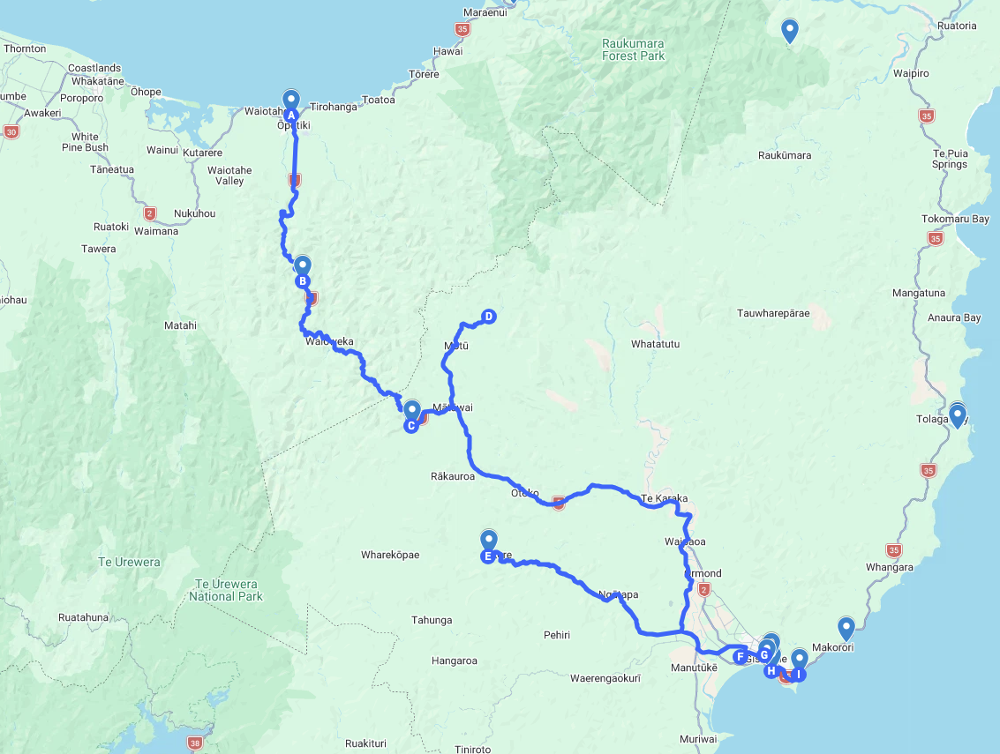
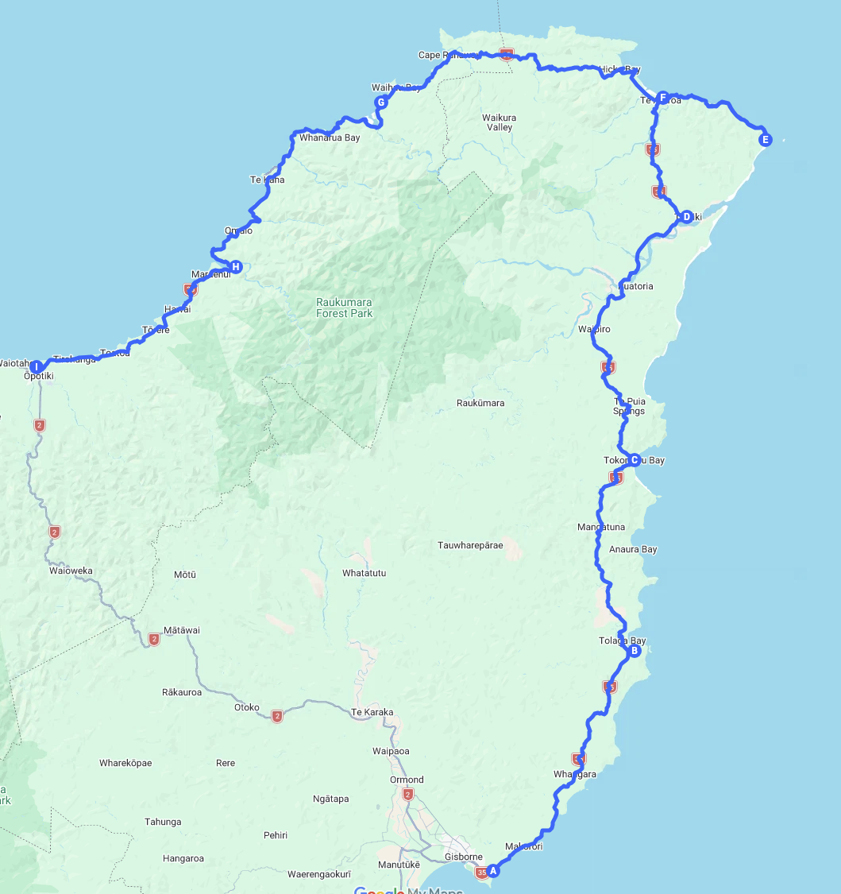

【快客攻略：奥波蒂基至吉斯本环线自驾全攻略】SH2峡谷与SH35太平洋海岸线二日游这份自驾指南将新西兰丰盛湾（Bay of Plenty）与东海岸（East Coast）两条极具代表性的景观公路—— SH2 怀奥埃卡峡谷线 与  SH35 太平洋海岸公路  完美串联，打造一条不走回头路的经典大环线行程。而且，这个行程有几个第一：新西兰现存唯一的百年“竖琴式”木悬索桥，世界罕见的“火车铁轨横穿飞机跑道”奇观，新西兰唯一一个火箭发射场，新西兰树龄最古老（约 600 年）、体量最大的波胡图卡瓦树，和世界上最早看到日出的地方。
<iframe 
  src="https://www.google.com/maps/d/embed?mid=1XlmOwOOBf3jYURbYaz1S5RhVvKiYjmo&ll=-37.94259063115041%2C177.90896264999998&z=9" 
  width="100%" 
  height="480" 
  style="border:0;" 
  allowfullscreen 
  loading="lazy">
</iframe>

---

## 1\. 二日环线概览与路线对比

从奥波蒂基出发前往吉斯本，去程穿越幽深的山林峡谷（SH2），回程沿着太平洋海岸线绕行新西兰最东端（SH35），两天行程动静结合，涵盖历史吊桥、天然水滑梯、野生黄貂鱼互动、百年栈桥与东角灯塔等核心亮点。

<iframe 
  src="https://www.google.com/maps/d/embed?mid=1XlmOwOOBf3jYURbYaz1S5RhVvKiYjmo&ll=-37.94259063115041%2C177.90896264999998&z=9" 
  width="100%" 
  height="480" 
  style="border:0;" 
  allowfullscreen 
  loading="lazy">
</iframe>

---

| 行程阶段 | 主要路线 | 驾车里程/时间 | 核心景观与体验 | 路线特色 |
| :---- | :---- | :---- | :---- | :---- |
| D1：峡谷山林线 | SH2 国道（经怀奥埃卡峡谷 | 约 150 公里 / 2.5 小时 | 陶朗加百年木吊桥、马塔瓦伊钢雕、雷雷天然水滑梯、吉斯本跑道穿轨奇观 | 森林峡谷、瀑布水滑梯、人文史迹 |
| D2：太平洋海岸线 | SH35 国道（经东角 | 约 330 公里 / 5.5 小时 | 塔塔波里野生黄貂鱼、图拉戈湾660米码头、东角灯塔、千年巨树、海边古教堂 | 太平洋海景、毛利圣山文化、灯塔与海岸小镇 |

---

只所以选择奥波蒂基（Ōpōtiki）出发，是因为从北面过来必经这个小镇。奥波蒂基（Ōpōtiki）位于丰盛湾东部海岸，是从奥克兰（约 4 小时 10 分）、汉密尔顿（约 3 小时 10 分）、陶朗加（约 1 小时 45 分）及华卡塔尼（约 35 分钟）南下进入东海岸的必经门户。作为交通枢纽，它恰好处于两条核心公路的分叉口：向南沿 2 号国道（SH2）穿越怀奥埃卡峡谷仅需 1 小时 45 分钟即可直达吉斯本，向东则踏上壮丽的 35 号太平洋海岸公路（SH35）绕行东角。由于进入这两条路线后补给点大幅减少，这里也是自驾客出发前加油与采购的最后大本营。

在人文与户外体验上，奥波蒂基拥有 800 年的毛利部落（Te Whakatōhea）定居历史，建于 1864 年的希奥纳圣斯蒂芬教堂（Hiona St Stephen's Church）深刻见证了新西兰土地战争时期的冲突与后来的族群和解。同时，这里也是新西兰国家骑行道网络 Motu Trails 的起点，既有适合亲子休闲的海岸沙丘步道（Dunes Trail），也有穿越原始雨林与高山峡谷的帕基希山道（Pakihi Track）和莫图公路线，无论历史探访还是骑行探险都极具特色。

---

## 2\. D1：去程——SH2 怀奥埃卡峡谷精华自驾

### 2.1 上午：奥波蒂基启程，深入怀奥埃卡峡谷（08:30 – 11:00）

* **08:30 奥波蒂基码头（Ōpōtiki Wharf）** ：出发前可在河畔散步、吹风，采购咖啡与早餐。

* **09:15 历史陶朗加吊桥（Historic Tauranga Bridge）** ：在 2 号国道旁停车场停靠，步行穿过原生蕨类森林，打卡新西兰现存唯一的百年“竖琴式”木悬索桥。

* **10:00 马塔瓦伊图腾柱（Hinetapuarau Statue）** ：在马塔瓦伊（Mātāwai）停靠，仰望 7 米高的纯白毛利祖先钢雕。

* **10:30 莫图瀑布（Motu Falls，可选绕行）** ：时间充裕可绕行碎石路，走晃悠吊桥近距离观赏森林瀑布（往返约加 45 分钟）。

### 2.2 中午：雷雷天然水滑梯与吉斯本午餐（11:30 – 14:00）

* **11:45 雷雷瀑布与岩石滑坡（Rere Falls & Rere Rockslide）** ：转入 Wharekopae Road，观赏宽阔的雷雷瀑布，并体验 60 米长的天然岩石水滑梯。

* **13:00 吉斯本市区午餐** ：推荐在 Bakery 22 品尝现烤肉派，或在港口边的 Marina Restaurant 享用海鲜。

### 2.3 下午：吉斯本海岸风光与文化打卡（14:00 – 16:45）

* **14:15 凯蒂山观景台（Kaiti Hill / Titirangi Reserve）** ：俯瞰吉斯本市区、贫穷湾白色悬崖与太平洋海岸。

* **15:00 怀努伊海滩（Wainui Beach）或酒庄小憩** ：前往冲浪胜地 Wainui Beach，或在 Matawhero Wines 品尝著名的吉斯本霞多丽。

* **16:00 跑道穿轨奇观（Gisborne Airport）** ：打卡世界罕见的“火车铁轨横穿飞机跑道”奇观。

### 2.4 傍晚：夜宿吉斯本或火箭发射观礼

* **观礼延伸方案** ：若逢 Rocket Lab 发射日，可驱车前往 Nūhaka 观礼区（127 Blucks Pit Road）观看火箭发射。 

---

## 3\. D2：返程——SH35 太平洋海岸公路景观全览

### 3.1 上午：浅海近距离接触野生黄貂鱼与百年长栈桥（08:30 – 12:00）

* **08:30 吉斯本出发前往塔塔波里（Dive Tatapouri）** ：在专业导游带领下，退潮时前往浅海礁石区，近距离观察并抚摸野生黄貂鱼（Stingrays）与鹰魟（Eagle Rays）。

* **09:45 图拉戈湾码头（Tolaga Bay Wharf）** ：漫步长达 660 米的南半球最长历史木结构码头。若体力充沛，可顺道走一段库克斯湾步道（Cooks Cove Walkway），探访库克船长当年停靠补充淡水的历史海湾与岩中洞。

* **11:15 托科马鲁湾（Tokomaru Bay）** ：在古朴海岸小镇的海边老码头遗址旁停靠，享受海风与咖啡。

### 3.2 中午：新西兰最东端灯塔与千年古树（12:30 – 15:00）

* **12:30 蒂阿拉罗瓦（Te Araroa）** ：参观新西兰树龄最古老（约 600 年）、体量最大的波胡图卡瓦树（Te Waha-o-Rerekohu）。

* **13:15 东角灯塔（East Cape Lighthouse）** ：驱车抵达新西兰本土最东端，攀登 700 级台阶登上灯塔顶部，俯瞰浩瀚太平洋全景。沿途可远眺纳提波鲁部落的神圣希库朗伊山（Maunga Hikurangi）。在蒂阿拉罗瓦小镇享用午餐简餐。这里可是世界上每天最早看见阳光的地方。

### 3.3 下午：毛利木雕教堂、孤悬海景教堂与沿海小镇（15:00 – 17:30）

* **15:15 提基提基教堂（Tikitiki St Mary's Church）** ：参观这座将传统毛利精美木雕与编织艺术融入圣堂的历史名教堂。

* **16:00 罗科科雷海边教堂（Raukokore Church）** ：打卡紧邻海岸线边缘的哥特式木质小教堂，这里是新西兰最具代表性的海岸摄影胜地之一。随后在怀豪湾（Waihau Bay）海边小店享用冰淇淋。

* **16:45 沿海景观公路返回（Omaio & Te Kaha）** ：沿 35 号国道经奥迈奥与特卡哈沿海公路行驶，欣赏丰盛湾东海岸落日美景。

### 3.4 傍晚：抵达奥波蒂基完成大环线（约 18:00）

* **18:00 抵达奥波蒂基（Ōpōtiki）** ：顺利结束 2 天的东海岸大环线自驾之旅。

---

## 4\. 自驾安全与实用补给提示

* **加油与加油站分布** ：  
* D1 怀奥埃卡峡谷段约 50 公里无加油站，请在奥波蒂基或吉斯本加满油。  
* D2 SH35 沿线加油站分布较稀疏（主要集中在 Tolaga Bay, Te Araroa, Te Kaha），建议车量剩半箱油时即及时补给。  
* **通讯与离线地图** ：  
* 山区与东角沿海部分路段无线信号较弱，请务必提前下载好离线地图（Google Maps 或 Maps.me）。  
* **海滩与潮汐安排** ：  
* 体验塔塔波里黄貂鱼互动及库克斯湾步道时需注意潮汐时间，退潮时体验最佳。随车准备毛巾与换洗衣物。

---

## 5\. 详细行程PDF
不想花几天时间自己查路线、算车程、对潮汐表？ 我已经把这次深度探索的所有精华，浓缩进这份[《奥波蒂基至吉斯本 & 东角环线终极自驾路书（PDF）》]（https://ko-fi.com/s/00af7d7c92）里了！里面不仅包含一日游和两日游可直接套用的保姆级行程表、精确到小时的驾驶与停留时间建议，还附赠我亲手制作的 Google My Maps 专属多图层路线链接（手机一键导入离线导航）以及退潮岩池、隐秘水滑梯、百年教堂和地道鲍鱼派的避坑贴士。点击下方按钮解锁完整路书，省下繁琐的攻略时间，把精力留给太平洋的第一缕日出！

---
【联系我们】
行程定制、包车、机场接送、微留学、亲子游、户外游、订住宿   
快客旅行（Xtravel Club）

PO Box 107129 Auckland Airport  
 Auckland 2150

Mobile/手机：022 496 4978  
Email/邮箱：info@xtravel.club  
Web /网站：http://xtravel.club  
微信号/QQ： 496 4978  
扫描关注我们的企业微信号:   
